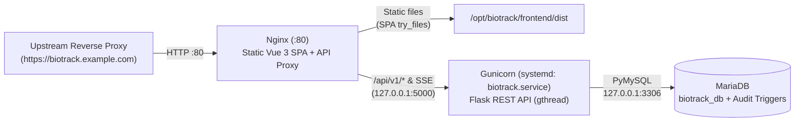

# BioTrack CMMS — Production Deployment Guide (Debian LXC)

## Target Environment
- **Host:** Debian GNU/Linux 13 (Trixie) LXC container (`<SERVER_IP>`)
- **Public DNS:** `biotrack.example.com` (TLS/HTTPS terminated by upstream reverse proxy)
- **Exposed Port:** `80/tcp` (HTTP only; `X-Forwarded-Proto` / `X-Forwarded-For` respected)
- **Install Path:** `/opt/biotrack`

---

## Architecture on the LXC Container



---

## Step-by-Step Deployment Plan

1. **System Packages (`apt`):**
   - Install `mariadb-server`, `nginx`, `python3-venv`, `python3-pip`, and `curl`.
   - Enable and start `mariadb` and `nginx` services.
2. **Application Directory & Dedicated Service User:**
   - Create system user `biotrack` (`--system --no-create-home`) to run Gunicorn with least privilege.
   - Create `/opt/biotrack/backend` and `/opt/biotrack/frontend/dist`.
   - Upload the Flask backend (`app/`, `migrations/`, `run.py`, `requirements.txt`) and the pre-built Vue 3 + Bootstrap 5 static bundle (`frontend/dist/`).
3. **Database Provisioning (MariaDB on `localhost`):**
   - Create database `biotrack_db` (`utf8mb4_unicode_ci`) and local user `'biotrack'@'127.0.0.1'` / `'biotrack'@'localhost'`.
   - Generate production `backend/.env` with cryptographically random `SECRET_KEY` and `JWT_SECRET_KEY`, and set `FRONTEND_URL=https://biotrack.example.com` so QR maintenance stickers point directly to your public HTTPS domain.
4. **Python Virtual Environment, Migrations & Seeder:**
   - Create `/opt/biotrack/backend/.venv`, install `requirements.txt` plus `gunicorn`.
   - Run `flask db upgrade` to apply all Alembic migrations.
   - Run `flask seed` to load the hospital, 4 clinical areas, 6 role accounts, closed symptom catalog, on-call roster, 12 medical assets, and MariaDB immutability triggers (`trg_audit_events_no_update`, `trg_audit_events_no_delete`).
5. **Systemd Service (`biotrack.service`):**
   - Run Gunicorn bound to `127.0.0.1:5000` with `--worker-class gthread --workers 2 --threads 8 --timeout 0` (prevents timeout disconnects on long-lived SSE `/api/v1/alerts/stream` connections).
   - Configure automatic restart on failure (`Restart=always`) and enable at boot.
6. **Nginx Reverse Proxy on Port 80 (`/etc/nginx/sites-available/biotrack`):**
   - Listen on `80 default_server` for `biotrack.example.com`.
   - Serve `/opt/biotrack/frontend/dist` with Vue Router history fallback (`try_files $uri $uri/ /index.html;`).
   - Proxy `/api/v1/alerts/stream` with `proxy_buffering off`, `proxy_cache off`, `proxy_read_timeout 3600s` for real-time Server-Sent Events.
   - Proxy `/api/` to `http://127.0.0.1:5000` forwarding `Host`, `X-Real-IP`, `X-Forwarded-For`, and `X-Forwarded-Proto`.
   - Disable the default Nginx site, validate with `nginx -t`, and reload Nginx.
7. **Live Verification:**
   - Verify `http://<SERVER_IP>/api/v1/health` returns `200 OK`.
   - Verify `http://<SERVER_IP>/` serves the Vue 3 SPA.
   - Verify `http://<SERVER_IP>/api/v1/public/verify/demo-qr-desf-01` returns the seeded defibrillator's public verification payload and QR SVG encodes `https://biotrack.example.com/verify/demo-qr-desf-01`.

---

## Operations & Maintenance Cheat Sheet

```bash
# Check service status & logs
systemctl status biotrack nginx mariadb
journalctl -u biotrack -f

# Re-seed demo data cleanly on the server
cd /opt/biotrack/backend
sudo -u biotrack .venv/bin/flask seed --reset

# Restart API after code updates
systemctl restart biotrack
```
