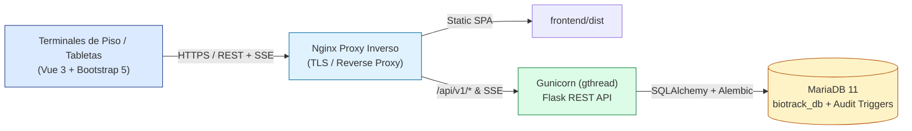
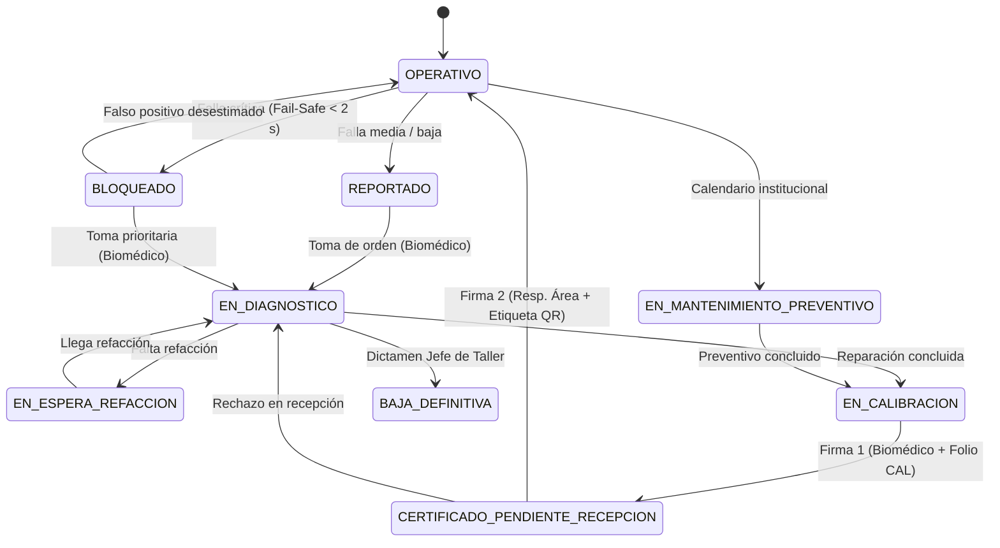

# 🏥 BioTrack CMMS

<div align="center">


**Sistema Hospitalario de Gestión de Incidentes, Trazabilidad y Mantenimiento de Equipamiento Médico**  
*Hospital BioTrack — Bloqueo Fail-Safe, Doble Validación y Bitácora Inmutable SHA-256*

---

**Materia:** Diseño de Sistemas de Software (Posgrado en Cómputo Aplicado, CUCEI — UDG)  
**Cliente / Product Owner:** M.C.C. Pablo Sainz Albanez | **Fecha:** Noviembre 2026

[🎯 Capacidades](#-capacidades-clave) • [🏗️ Arquitectura](#️-arquitectura-del-sistema) • [🔐 Seguridad y QA](#-seguridad-cumplimiento-y-qa) • [🚀 Instalación](#-instalación-y-ejecución) • [📚 Documentación](#-documentación-y-estructura)

</div>

---

## 🎯 Capacidades Clave

<table>
<tr>
<td width="50%">

### 🛡️ Seguridad del Paciente (Fail-Safe)
```
Bloqueo Atómico en Servidor:
├─ Reporte guiado en 3 pasos (< 30 s)
├─ Bloqueo inmediato OPERATIVO → BLOQUEADO (< 2 s)
├─ Doble Validación obligatoria (Firma 1 + Firma 2)
└─ Rechazo en recepción devuelve a EN_DIAGNOSTICO
```

</td>
<td width="50%">

### 📜 Auditoría Inmutable (COFEPRIS)
```
Trazabilidad Criptográfica:
├─ Tabla audit_events solo inserción (append-only)
├─ Triggers MariaDB (BEFORE UPDATE / DELETE)
├─ Cadena SHA-256 verificable en < 5 s
└─ Etiqueta física con QR de consulta pública
```

</td>
</tr>
</table>

### 🏆 Atributos de Calidad Verificados (`BioTrack_SDS_v0.3`)

| ID | Atributo de Calidad | Meta Arquitectural | Estado |
|:--:|---------------------|--------------------|:------:|
| **QA-01** | Seguridad del paciente (*safety*) | Bloqueo atómico *fail-safe* en `< 2 s` | ✅ Verificado |
| **QA-02** | Usabilidad bajo estrés clínico | Reporte en 3 pasos en `< 30 s` (nominal `20 s`) | ✅ Verificado |
| **QA-03** | Seguridad: integridad y no repudio | Rechazo de `UPDATE`/`DELETE` + cadena `SHA-256` | ✅ Verificado |
| **QA-04** | Disponibilidad (operación 24/7) | Disponibilidad objetivo `≥ 99.5 %` (`systemd` LXC) | 🟡 En observación |
| **QA-05** | Seguridad: auditabilidad | Expediente COFEPRIS + verificación en `< 5 s` | ✅ Verificado |
| **QA-06** | Seguridad: control de acceso | RBAC (6 roles) + Doble Firma con reautenticación | ✅ Verificado |
| **QA-07** | Desempeño: notificación en guardia | Despacho SSE `< 5 s` y escalamiento (`5 min` / `10 min`) | ✅ Verificado |

> 💡 **Cumplimiento Normativo:** Alineado con **NOM-016-SSA3-2012** (infraestructura y trazabilidad CENAM), **NOM-240-SSA1-2012** (tecnovigilancia), **NOM-241-SSA1-2025** (buenas prácticas de dispositivos médicos) y **NOM-151-SCFI-2016** (conservación digital e integridad).

---

## 🏗️ Arquitectura del Sistema

### Vista de Componentes y Despliegue en Producción



### 🔄 Máquina de Estados Gobernada en Servidor (`AD-03`)



### 🖥️ Stack Tecnológico

<details>
<summary><b>⚙️ Backend, Base de Datos e Infraestructura</b> (Click para expandir)</summary>

```yaml
Backend:
  - Lenguaje: Python 3.11+
  - Framework: Flask (Blueprints REST API)
  - ORM & Migraciones: SQLAlchemy + Flask-Migrate (Alembic)
  - Seguridad: JWT + PBKDF2-SHA256 + Reautenticación en firmas
  - Alertas en Tiempo Real: Server-Sent Events (SSE)
Base de Datos:
  - Motor: MariaDB 11 (InnoDB, ACID)
  - Inmutabilidad: Triggers BEFORE UPDATE / BEFORE DELETE (SQLSTATE 45000)
  - Esquema: 11 tablas relacionales con soporte multi-tenant (hospital_id)
Producción:
  - Sistema Operativo: Debian 13 (contenedor LXC)
  - WSGI: Gunicorn (--worker-class gthread --workers 2 --threads 8 --timeout 0)
  - Proxy Inverso: Nginx (proxy_buffering off para SSE)
```

</details>

<details>
<summary><b>🎨 Frontend & Factores Humanos (ISO 9241)</b> (Click para expandir)</summary>

| Característica | Implementación | Propósito |
|----------------|----------------|-----------|
| **Framework SPA** | Vue 3 + Pinia + Vue Router + Bootstrap 5 | Interfaz responsiva para PCs y tabletas clínicas |
| **Terminal de Piso** | `FloorTerminalView.vue` (stepper de 3 pasos) | Captura sin texto libre obligatorio en `< 30 s` |
| **Guía por Rol** | `RoleGuideModal.vue` | Instrucciones paso a paso integradas por perfil |
| **Alertas Activas** | `alerts.js` (SSE + Web Audio) | Notificación sonora inmediata al taller y guardias |
| **Verificación QR** | `StickerPrintModal.vue` + `PublicVerifyView.vue` | Etiqueta imprimible y consulta pública sin login |
| **Auditoría COFEPRIS** | `AuditView.vue` (Timeline SmartArt + tablas) | Expediente verificable e imprimible en un clic |

</details>

---

## 🔐 Seguridad, Cumplimiento y QA

### 🧪 Suite Automatizada de Integración (`pytest` sobre MariaDB Real)

<details open>
<summary><b>📋 7/7 Casos Automatizados Aprobados (<code>test_biotrack_core.py</code>)</b></summary>

| ID | Prueba Automatizada | Atributos | Validación Clave | Estado |
|:--:|---------------------|:---------:|------------------|:------:|
| **TC-01** | `test_failsafe_critical_block_and_oncall_dispatch` | `QA-01`, `QA-07` | Bloqueo atómico `< 2.0 s` y alerta `PENDIENTE` a guardia | ✅ PASS |
| **TC-02** | `test_two_person_rule_and_public_qr_verification` | `QA-06`, `QA-05` | Bloqueo de saltos (`409`), Firma 1 (`CAL-YYYY-XXXXX`), bloqueo autofirma (`403`), Firma 2 y QR público | ✅ PASS |
| **TC-03** | `test_audit_immutability_triggers_and_sha256_verification` | `QA-03`, `QA-05` | Integridad `SHA-256` y rechazo por *triggers* MariaDB ante `UPDATE`/`DELETE` | ✅ PASS |
| **TC-04** | `test_oncall_escalation_to_workshop_chief` | `QA-07` | Escalamiento automático a `ESCALADO` hacia Jefe de Taller | ✅ PASS |
| **TC-05** | `test_executive_kpis_and_preventive_due` | `QA-05`, `QA-01` | Cálculo de los 5 KPIs directivos y detección de 3 ventiladores próximos a preventivo | ✅ PASS |
| **TC-06** | `test_false_positive_dismissal_does_not_affect_metrics` | `QA-05` | Desestimación de falso positivo sin penalizar SLA ni MTTR | ✅ PASS |
| **TC-07** | `test_firma2_rejection_returns_to_workshop` | `QA-01`, `QA-06` | Rechazo en recepción devuelve activo a `EN_DIAGNOSTICO` | ✅ PASS |

</details>

### 👥 Roles y Credenciales de Demostración

<details>
<summary><b>🔑 Usuarios Precargados (Contraseña: <code>BioTrack2026!</code>)</b></summary>

| Rol | Correo | Flujo Principal en Demo |
|-----|--------|-------------------------|
| **Personal Clínico** | `clinico@biotrack.mx` | Reporte `< 30 s` en Terminal de Piso y bloqueo *Fail-Safe* |
| **Ing. Biomédico (Guardia)** | `biomedico@biotrack.mx` | Taller, diagnóstico, falsos positivos, calibración y **Firma 1** |
| **Jefe de Taller** | `jefe.taller@biotrack.mx` | Escalamiento de alertas críticas, guardias y Baja Definitiva |
| **Responsable de Área** | `responsable@biotrack.mx` | **Firma 2** (Doble Validación), rechazo en recepción y etiqueta QR |
| **Dirección Médica** | `direccion@biotrack.mx` | Cuadro de Mando con los 5 Indicadores Ejecutivos (`ConOps v0.2`) |
| **Auditor COFEPRIS** | `auditor@cofepris.mx` | Expediente solo lectura, línea del tiempo, verificador `SHA-256` y reporte imprimible |

🔗 **Verificación Pública QR (sin login, local):** `http://localhost:5173/verify/demo-qr-desf-01`

</details>

---

## 🚀 Instalación y Ejecución

<table>
<tr>
<td width="50%">

### 🐍 Backend (Flask + MariaDB)
```powershell
cd biotrack\backend
python -m venv .venv
.\.venv\Scripts\activate
pip install -r requirements.txt
copy .env.example .env
flask db upgrade
flask seed --reset
python run.py
```

</td>
<td width="50%">

### ⚡ Frontend (Vue 3 + Vite)
```powershell
cd biotrack\frontend
npm install
npm run dev
```

### 🧪 Ejecutar Pruebas (`pytest`)
```powershell
cd biotrack\backend
.\.venv\Scripts\pytest.exe -v
```

</td>
</tr>
</table>

> 📖 Para despliegue en servidor Linux con `Gunicorn + Nginx + MariaDB`, consultar [`DEPLOYMENT.md`](./DEPLOYMENT.md).

---

## 📚 Documentación y Estructura

| Recurso | Descripción | Archivo |
|---------|-------------|---------|
| **Guía de Despliegue** | Configuración en Linux con Gunicorn, Nginx y MariaDB | [`DEPLOYMENT.md`](./DEPLOYMENT.md) |
| **Licencia** | Términos de uso del repositorio | [`LICENSE`](./LICENSE) |

> 📌 El diseño y verificación del sistema siguen los estándares **IEEE Std 1362-1998** (ConOps), **IEEE Std 1016-2009** (SDS) e **IEEE Std 730-2014** (SQAP).

<details>
<summary><b>📁 Estructura del Repositorio</b> (Click para expandir)</summary>

```text
biotrackCMMS/
├── README.md                                       # Este documento
├── LICENSE                                         # Licencia del repositorio
├── DEPLOYMENT.md                                   # Guía de despliegue (Gunicorn + Nginx + MariaDB)
├── backend/
│   ├── app/
│   │   ├── api/                                    # Blueprints REST + SSE
│   │   ├── models/                                 # 11 entidades SQLAlchemy
│   │   ├── services/                               # Máquina de estados, SHA-256, RBAC, KPIs
│   │   └── seed.py                                 # Sembrador determinista + triggers MariaDB
│   ├── migrations/                                 # Migraciones Alembic
│   └── tests/                                      # Suite pytest (7/7 tests)
└── frontend/
    └── src/
        ├── components/                             # Navbar, ReauthModal, RoleGuideModal, QR
        ├── stores/                                 # Pinia (auth, alerts SSE)
        └── views/                                  # Floor, Workshop, Reception, Audit, Dashboard
```

</details>

---

## 👥 Equipo de Ingeniería y Consultoría

| Integrante | Rol Principal |
|------------|---------------|
| **Dalia Edith Ponce** | Product Owner y Gestión del Proceso |
| **Martin Mathier Mendoza Morelos** | Arquitectura de Software y Backend |
| **Carlos Alberto Guzmán Montes** | Aseguramiento de Calidad (SQA), Ciberseguridad y Compliance |
| **Josef Zizka** | Ingeniería de Software, Trazabilidad y Auditoría COFEPRIS |
| **Oscar David Flores** | Especialista Biomédico y Marco Normativo |
| **Luis Armando Dueñas Reyna** | Ingeniería de Procesos Clínicos y Taller Biomédico |
| **Araceli Moreno Gonzalez** | Factores Humanos y Ergonomía Cognitiva (ISO 9241) |
| **Jules Nogales** | Ingeniería de Software — Lógica de Dominio y Máquina de Estados |
| **Juan Francisco Camarillo Farias** | Ingeniería de Software — Frontend y Experiencia en Piso |

---

<div align="center">

**BioTrack CMMS — Hospital BioTrack**  
Posgrado en Cómputo Aplicado · CUCEI · Universidad de Guadalajara  
Noviembre 2026

[](./LICENSE)
[](#-documentación-y-estructura)

</div>
